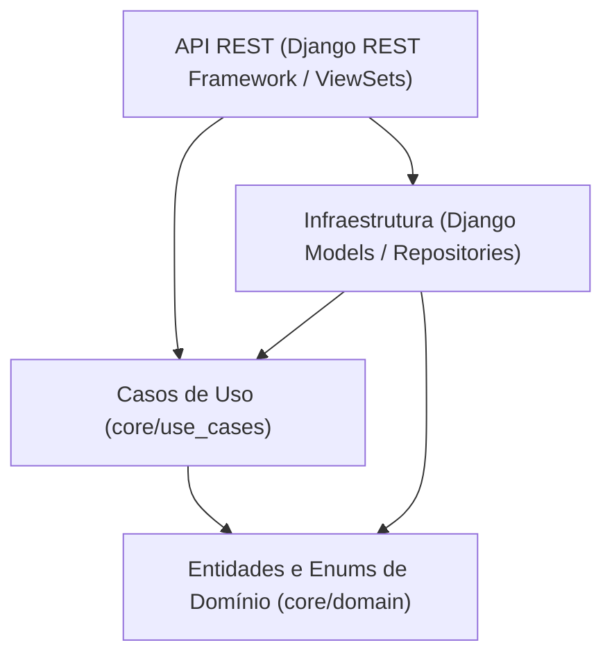

# Arquitetura — DriveHub API

## 1. Visão Geral
A **DriveHub API** adota uma arquitetura em camadas concêntricas baseada em **Clean Architecture** e **Domain-Driven Design (DDD)**. O princípio fundamental é a **Regra da Dependência**: o código das camadas mais internas (domínio e casos de uso) não possui qualquer dependência de frameworks, bibliotecas de terceiros ou mecanismos de persistência externa.

---

## 2. Camadas do Sistema

### 2.1. Núcleo de Domínio (`core/domain/`)
- Totalmente agnóstico ao framework web e ao banco de dados.
- **Entidades:** `Vehicle`, `Brand`, `SaleProposal`.
- **Enums:** `VehicleStatus` (`AVAILABLE`, `RESERVED`, `SOLD`), `PaymentMethod` (`CASH`, `FINANCED`, `CARD`), `ProposalStatus` (`PENDING_MANAGER`, `APPROVED`, `REJECTED`, `COMPLETED`).
- **Exceções:** `DomainException` utilizada para sinalizar quebra de invariantes.
- **Portas (Interfaces):** `VehicleRepositoryInterface` e `SaleProposalRepositoryInterface` definem os contratos que qualquer adaptador de persistência deve cumprir.

### 2.2. Casos de Uso (`core/use_cases/`)
- Orquestram as regras de negócio da aplicação.
- `CreateVehicleUseCase`: Validação de quilometragem não negativa e ano do modelo maior ou igual ao ano de fabricação.
- `UpdateVehicleMileageUseCase`: Auditoria e garantia de que a quilometragem nunca seja reduzida retroativamente.
- `CreateSaleProposalUseCase`: Aplicação de regras de alçada de desconto e entrada mínima de 20% para financiamentos.
- `ApproveSaleProposalUseCase`: Transição de proposta para `APPROVED`.
- `CompleteSaleUseCase`: Finalização da proposta (`COMPLETED`) e transição atômica do status do veículo para `SOLD`.

### 2.3. Infraestrutura & Adaptadores (`apps/`)
- **Adaptadores de Persistência:** `DjangoVehicleRepository` e `DjangoSaleProposalRepository` convertem chamadas de repositório para o Django ORM, encapsulando os models (`VehicleModel`, `BrandModel`, `SaleProposalModel`).
- **Adaptadores HTTP / REST:** `VehicleViewSet` e `SaleProposalViewSet` utilizam serializers do Django REST Framework para validar payloads e formatar respostas JSON.
- **Transacionalidade:** Ações que modificam agregados múltiplos são protegidas por `@transaction.atomic`.
- **Autorização (RBAC):** `IsManager` restringe ações críticas de aprovação e conclusão exclusivamente a usuários com perfil de Gerente (`is_staff`, `is_superuser` ou grupos `Manager`/`Gerente`).

---

## 3. Estratégia de Persistência e Concorrência
- **Ambiente de Desenvolvimento:** SQLite com serialização a nível de transação.
- **Ambiente de Produção (Alvo):** PostgreSQL com `select_for_update()` ativado na camada de repositório para isolamento real de concorrência com bloqueio a nível de linha (row-level locking via MVCC).

---

## 4. Rastreabilidade com o Frontend
O schema da API é exposto via OpenAPI 3 / Swagger através da biblioteca `drf-spectacular` nos caminhos:
- Schema JSON/YAML: `/api/schema/`
- Interface Interativa: `/api/docs/`
